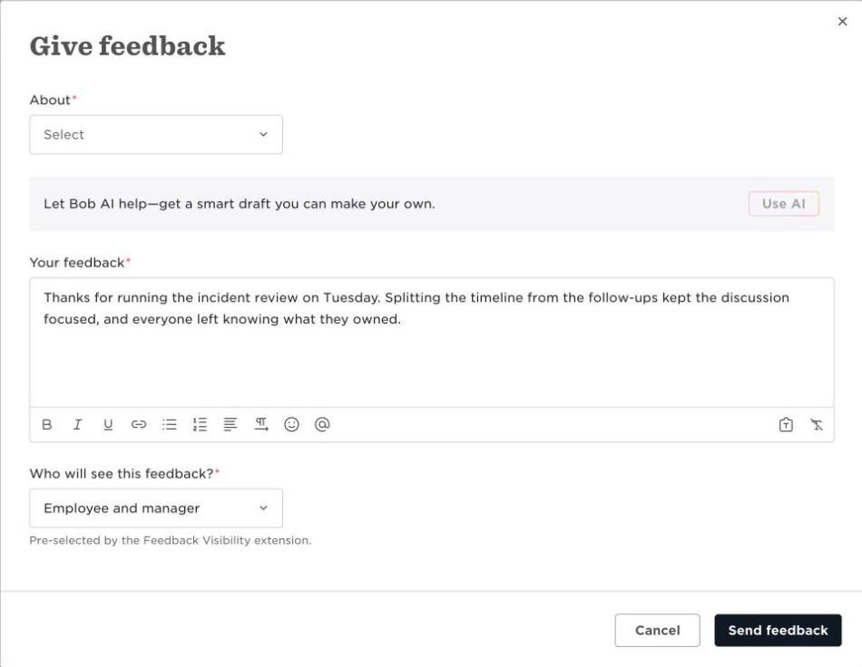

# Feedback Visibility Default for HiBob

An unofficial Chrome extension for [HiBob](https://app.hibob.com). When you open **Give feedback** or **Request feedback**, it changes **Who will see this feedback?** from *Managers* to *Employee and manager* for you.

It does this once, as the form opens, and shows a small note under the field saying it did. If you pick something else afterwards, your choice stays and the note goes away.



## Install (5 minutes, no technical knowledge needed)

1. Go to the [latest release](https://github.com/jacobo-doist/feedback-visibility-hibob/releases/latest) and download **feedback-visibility-hibob.zip** (under *Assets*).
2. Double-click the zip to unzip it. You get a folder called **feedback-visibility-hibob**.
3. Move that folder somewhere you won't delete it by accident, for example your *Documents* folder. Chrome runs the extension from this folder, so if you delete it the extension stops working.
4. In Chrome, open a new tab, type `chrome://extensions` in the address bar and press Enter.
5. Turn on **Developer mode** with the switch in the top-right corner.
6. Click **Load unpacked** (top-left) and select the **feedback-visibility-hibob** folder from step 3.
7. A card called **Feedback Visibility Default for HiBob** appears. You're done. Reload any HiBob tab you already had open.

Chrome may show a banner about developer-mode extensions when it starts. That is expected for extensions installed this way; close it.

## Update

1. Download the new zip from the [latest release](https://github.com/jacobo-doist/feedback-visibility-hibob/releases/latest) and unzip it.
2. Replace the old **feedback-visibility-hibob** folder with the new one, in the same place.
3. Open `chrome://extensions` and click the circular reload arrow on the **Feedback Visibility Default for HiBob** card.

## Uninstall

Open `chrome://extensions`, click **Remove** on the **Feedback Visibility Default for HiBob** card, then delete the folder.

## Good to know

- **Always glance at the field before sending.** If HiBob changes its form, the extension may stop working, and the field will quietly keep HiBob's default (*Managers*).
- **English only.** It looks for the option labels *Managers* and *Employee and manager*, so it does nothing if your HiBob is set to another language.
- **What it touches.** Chrome will say it can "read and change your data on app.hibob.com", because that is how Chrome describes any extension that runs on a site. In practice it waits for the Give feedback or Request feedback form to open and changes that one field. It does nothing anywhere else in HiBob, and it reads nothing beyond that field's current value.
- **Privacy.** It runs on no other site, asks for no other permissions, sends nothing anywhere and stores nothing. The whole extension is [one short script](extension/content.js) you can read.

## For maintainers

The extension lives in `extension/`. To try a change, load that folder with **Load unpacked** and click the reload arrow on its card after editing. Its icons are drawn in `store/icon.svg` and rendered with `node store/make-icons.mjs`.

To release, bump `version` in `extension/manifest.json`, commit, then tag and push:

```sh
git tag v<version> && git push origin v<version>
```

The Release workflow runs `scripts/release.sh`, which checks the tag matches the manifest, builds the zip with `scripts/package.sh` and creates the GitHub release. For the Chrome Web Store, upload the zip from that release (or run `scripts/package.sh` locally) in the Developer Dashboard; `store/listing.md` has the listing text.
